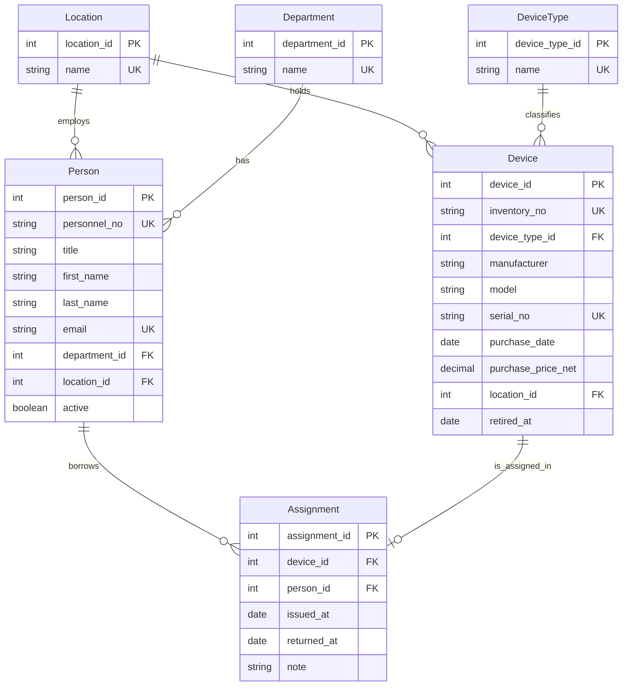

## ERD

## Entitäten

### Stammdaten

| Entität | Wichtige Attribute |
|---|---|
| **Person** | `personnel_no` (fachlicher Schlüssel, z. B. 1001), `title` (optional), `first_name`, `last_name`, `email` (optional), `active` |
| **Device** | `inventory_no` (fachlicher Schlüssel, z. B. G0001), `manufacturer`, `model`, `serial_no` (optional), `purchase_date`, `purchase_price_net`, `retired_at` (optional, ausgemustert) |
| **DeviceType** | `name` |
| **Location** | `name` |
| **Department** | `name` |

### Bewegungsdaten

| Entität | Wichtige Attribute |
|---|---|
| **Assignment**  | `issued_at` (Ausgabe), `returned_at` (Rückgabe, leer = noch ausgeliehen), `note` (optional) |

## Fachregeln

Das ERD zeigt nur Entitäten, Attribute, Schlüssel und Kardinalitäten. Die folgenden Regeln gelten zusätzlich.

| Nr. | Regel                                                                                                           | 
|-----|-----------------------------------------------------------------------------------------------------------------|
| R1  | Zuweisungen desselben Geräts dürfen sich zeitlich nicht überschneiden.                                          | 
| R2  | `returned_at` darf nicht vor `issued_at` liegen.                                                                |
| R3  | `issued_at` darf nicht vor dem `purchase_date` des Geräts liegen.                                               | 
| R4  | `issued_at`, `returned_at` und `purchase_date` dürfen nicht in der Zukunft liegen.                              | 
| R5  | Zuweisungen werden nie gelöscht; eine Rückgabe wird nur durch Setzen von `returned_at` erfasst.                 |
| R6  | `purchase_price_net` ist ≥ 0.                                                                                   | 
| R7  | `retired_at` darf nicht vor `purchase_date` liegen.                                                             | 
| R8  | Ein Gerät kann nur ausgemustert und eine Person nur deaktiviert werden, wenn keine aktive Zuweisung mehr besteht. |
| R9  | Titel und akademische Grade stehen nur in `title`, nicht in `first_name` oder `last_name`.                      |

## UK- und Constraint-Ideen

| Tabelle | Spalte(n) | Bemerkung |
|---|---|---|
| Person | `personnel_no` | fachlicher Schlüssel |
| Person | `email` | optional; eindeutig, falls vorhanden, ohne Beachtung der Groß-/Kleinschreibung |
| Device | `inventory_no` | fachlicher Schlüssel |
| Device | `serial_no` | optional; eindeutig, falls vorhanden (ggf. nur je Hersteller) |
| Location, Department, DeviceType | `name` | keine doppelten Stammdaten, ohne Beachtung der Groß-/Kleinschreibung |
| Assignment | `device_id` nur für Zeilen mit `returned_at IS NULL` |